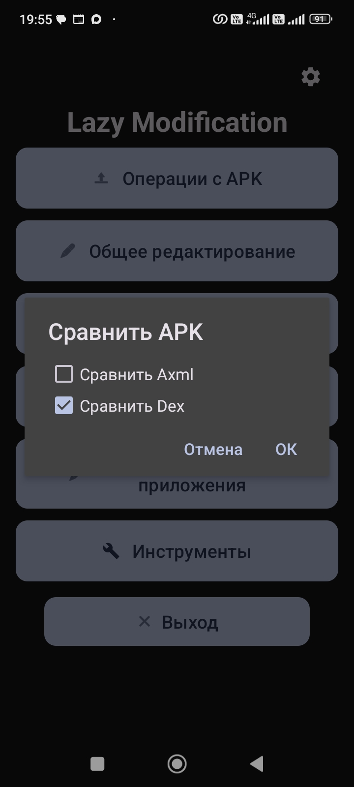
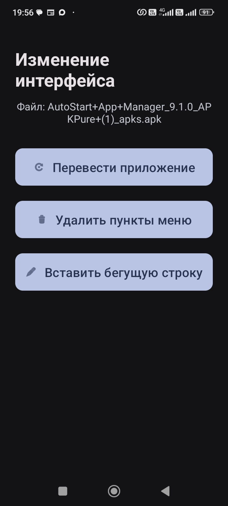
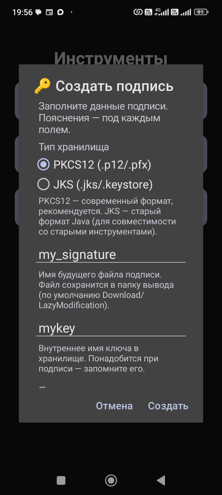
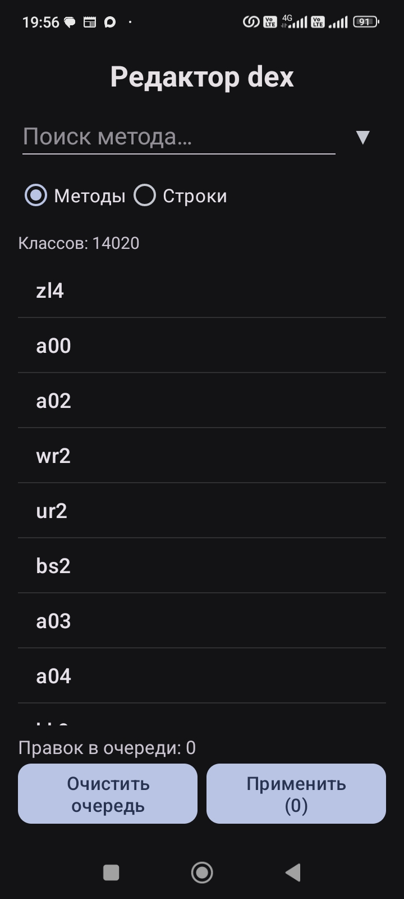

# Lazy Modification

<p align="center">
  
</p>

**Версия: 1.28** · Обновлено: 25.10.2026

**Lazy Modification** — программа для работы с APK, APKS и XAPK файлами, а также патчинга APK.

В основном — для тех, кто не разбирается в модифицировании APK, а свой мод хочется. Здесь всё просто: выбрал файл, поставил галочки — и получил готовое без лишних телодвижений.

## Возможности

* Конвертация APKS
* Извлечение из установленных
* Разделение по архитектурам
* Клонирование
* Общее редактирование
* Изменение интерфейса
* Перевод приложения
* Инспектор APK
* Сравнение APK
* Патчинг
* Создание подписи (PKCS12 / JKS)

## Скриншоты

<p align="center">
  
  
  
  
</p>

<p align="center">
  
  
  
  
</p>

## Рабочая папка

* **Рабочая папка**: в «Настройках» появился выбор папки, с которой открывается файловый менеджер
* **Выбор папки на SD-карте**: отдельный экран с переключением между внутренней памятью и картой памяти
* **Сохранение выбора**: рабочая папка запоминается и применяется при следующем выборе APK/APKS/XAPK
* **Сброс**: в диалоге рабочей папки можно вернуться к последней открытой папке

## Кэш

* В «Истории» показывается, сколько места занимает кэш разобранных APK
* Перед удалением показывается, сколько можно освободить; после удаления — сколько освободилось
* История патчей и настройки при очистке кэша не затрагиваются

## Что нового в 1.28

* **Рабочая папка**: выбор начальной папки для файлового менеджера, в том числе на SD-карте
* **Размер кэша**: перед удалением показывается, сколько места можно освободить
* **Android 10 — подпись**: встроенный ключ переведён на JKS, чтобы не зависеть от системного PKCS12 с PBES2/PBKDF2
* **Исправлен `VerifyError` после патчинга**: адреса `try/catch` пересчитываются после изменения инструкций dex
* **Стабильнее чтение сертификата**: используется apksig, плюс запасной вариант из установленного приложения
* **Сохранение opcodes dex**: при пересборке больше не навязывается API 28

## Что нового в 1.27.1

* **Исправлена ошибка сохранения перевода на Android 10**: подпись встроенным `testkey.p12` больше не использует системный PKCS12, который не умеет PBES2/PBKDF2
* Исправление затрагивает все сценарии со встроенным ключом: перевод приложения, патчинг и другие операции с переподписью

## Что нового в 1.27

* **Кэш разобранного APK**: повторный патч не выполняет распаковку и baksmali заново
* **История и откат**: снимок исходного APK перед каждым патчем, список запусков и восстановление
* **Скачивание патчей APK Editor** из темы 4PDA в «Инструментах»
* **Проверка совместимости ZIP-патчей** по пакету, versionName и versionCode
* **Копирование текста** из лога патчинга, лога конвертации и отчёта анализатора
* Исправлена подпись PKCS12 на Android 10 (PBES2/PBKDF2 через BouncyCastle)

## Что нового в 1.26

* **Патчи APK Editor**: в «Патчинге» появилась кнопка выбора ZIP/TXT-патчей, можно применять несколько файлов последовательно
* **Редактор патчей** в «Инструментах»: создание, импорт, проверка и сохранение ZIP-патчей
* **Исправлен OOM при smali-патчинге**: большие APK больше не падают при пересборке dex, изменённые классы собираются точечно
* **Исправлен разбор `${...}` на Android**: ошибка `EXECUTE_DEX` устранена
* **Форма «Патчинг»**: убраны лишние подписи, конфликтующие встроенные опции блокируются при выборе APK Editor-патча
* **Экран «Подпись APK»**: переподпись выбранного APK и создание собственного ключа

## Что нового в 1.25

* **Краш после патча — исправлено**: перепаковка больше не повышает версию формата dex (035 → 039), из-за чего часть приложений не запускалась после патчинга
* **Размер после патчинга**: изменённые dex сохраняют упаковку оригинала — итоговый APK больше не раздувается на десятки МБ
* **Ползунки прокрутки**: перетаскиваются пальцем — в файловом менеджере, списках, логе, сравнении, переводе и извлечении
* **Тёмная тема**: найденное слово в редакторе dex больше не «пропадает» (список результатов и экран метода)
* **Кнопка отключения проверки подписи** перенесена в «Патчинг» — сразу после «Инспектор APK»
* **Перестановка в «Инструментах»**: «Редактор Dex» — наверх, «Сравнить APK» — в «Инструменты»
* Файловый менеджер запоминает последнюю открытую папку
* Точный прогресс патчинга: этапы, подробности, корректное завершение
* Экран лога больше не «зависает» по завершении патча

## Требования

* Android 5.0 и выше
* Интерфейс: русский / English / български

## Сборка

```bash
./gradlew assembleDebug
```

## Ссылки

* Обсуждение и обновления на 4PDA: [тема программы](https://4pda.to/forum/index.php?showtopic=1123930)
* Скачать APK: [Releases](https://github.com/Garant68/LazyModification/releases)
* Разработчик: **Garant68**
* Имя пакета: `com.example.lazymodification`

---

*Программа предоставляется «как есть». Используйте на свой страх и риск.*
