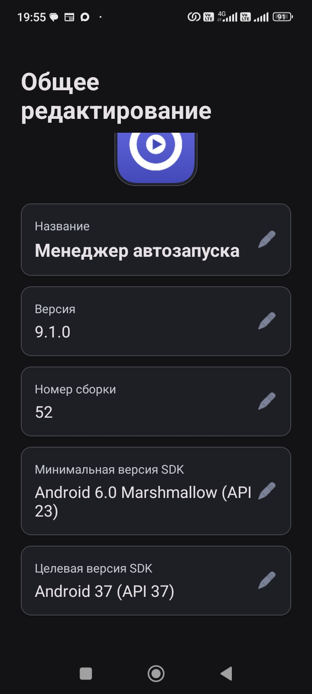
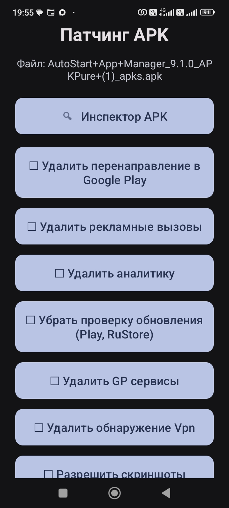

# Lazy Modification

<p align="center">
  
</p>

**Версия: 1.24** · Обновлено: 12.10.2026

**Lazy Modification** — программа для работы с APK, APKS и XAPK файлами, а также патчинга APK.

В основном — для тех, кто не разбирается в модифицировании APK, а свой мод хочется. Здесь всё просто: выбрал файл, поставил галочки — и получил готовое без лишних телодвижений.

## Возможности

* Конвертация APKS
* Извлечение из установленных
* Разделение по архитектурам
* Клонирование
* Общее редактирование
* Изменение интерфейса
* Перевод приложения
* Инспектор APK
* Сравнение APK
* Патчинг
* Создание подписи (PKCS12 / JKS)

## Скриншоты

<p align="center">
  
  
  
  
</p>

## Что нового в 1.24

* **Редактор Dex** («Инструменты»): dex-редактор — заглушение и очистка методов, просмотр кода метода в стиле MT (метки, регистры), редактирование инструкций с проверкой, переход «К методу»
* **Поиск в редакторе**: по классам, методам (по имени и по коду) и строкам; поддержка регулярных выражений; сохранение поисковых запросов
* **Проверка подписи** («Инструменты»): «Удалить проверку подписи» — встраивает движок, отключающий проверки подписи (совместимо по результату с MT Manager)
* **Конвертация APKS/XAPK**: предупреждение о подписи и кнопка «Подписать своим ключом»; при объединении сплитов сохраняются данные оригинальной V1-подписи
* **Патчинг**: новая опция «Разрешить скриншоты»
* Внутренние улучшения и исправления (работа с dex, сравнение APK)

## Требования

* Android 5.0 и выше
* Интерфейс: русский / English / български

## Сборка

```bash
./gradlew assembleDebug
```

## Ссылки

* Обсуждение и обновления на 4PDA: [тема программы](https://4pda.to/forum/index.php?showtopic=1123930)
* Скачать APK: [Releases](https://github.com/Garant68/LazyModification/releases)
* Разработчик: **Garant68**
* Имя пакета: `com.example.lazymodification`

---

*Программа предоставляется «как есть». Используйте на свой страх и риск.*
